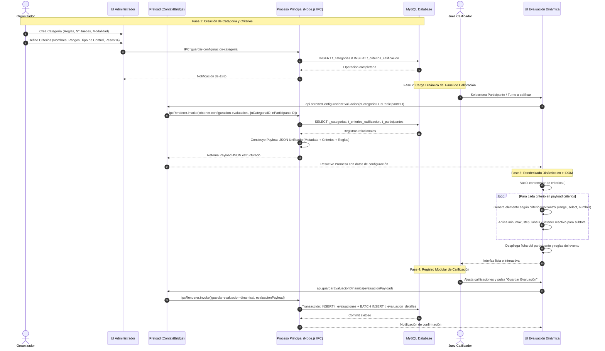

# Arquitectura y Diseño del Sistema Modular de Competencias y Evaluaciones

Este documento define la arquitectura técnica, modelo de datos relacional, flujos IPC para Electron y especificaciones de renderizado dinámico para transformar el sistema de evaluación en una plataforma **100% modular y adaptable a cualquier tipo de competencia** (baile tradicional, gastronomía, artes marciales/combate, competencias académicas, etc.).

---

## 1. Modelo de Datos Relacional (MySQL)

El diseño rompe la dependencia de campos fijos (como `aspecto1`, `aspecto2`, `nParejaID`, etc.), organizando el sistema en entidades normalizadas con soporte para reglas y metadatos flexibles mediante columnas JSON.

```sql
-- =============================================================================
-- ESQUEMA MODULAR PARA SISTEMA DE COMPETENCIAS Y EVALUACIONES MULTI-EVENTO
-- =============================================================================

-- 1. Tabla de Eventos Generales
CREATE TABLE IF NOT EXISTS t_eventos (
    nEventoID INT AUTO_INCREMENT PRIMARY KEY,
    cNombre VARCHAR(150) NOT NULL,
    cDescripcion TEXT NULL,
    cTipoEvento VARCHAR(50) NOT NULL COMMENT 'Ej: danza, gastronomia, combate, arte, academico',
    dFechaInicio DATETIME NOT NULL,
    dFechaFin DATETIME NULL,
    cEstado ENUM('borrador', 'activo', 'finalizado', 'cancelado') DEFAULT 'borrador',
    dFechaCreacion TIMESTAMP DEFAULT CURRENT_TIMESTAMP
) ENGINE=InnoDB DEFAULT CHARSET=utf8mb4 COLLATE=utf8mb4_unicode_ci;

-- 2. Tabla de Categorías (Configuración modular e independiente por competencia)
CREATE TABLE IF NOT EXISTS t_categorias (
    nCategoriaID INT AUTO_INCREMENT PRIMARY KEY,
    nEventoID INT NOT NULL,
    cNombre VARCHAR(120) NOT NULL,
    cDescripcion TEXT NULL,
    cModalidad ENUM('individual', 'pareja', 'equipo') DEFAULT 'individual',
    nMinJuecesRequeridos INT UNSIGNED DEFAULT 3 COMMENT 'Cantidad mínima de jueces por categoría',
    jReglas JSON NULL COMMENT 'Reglas específicas, tiempos límite, indumentaria, penalizaciones',
    cEstado ENUM('activa', 'cerrada', 'en_evaluacion', 'finalizada') DEFAULT 'activa',
    dFechaCreacion TIMESTAMP DEFAULT CURRENT_TIMESTAMP,
    CONSTRAINT fk_categoria_evento FOREIGN KEY (nEventoID) 
        REFERENCES t_eventos(nEventoID) ON DELETE CASCADE
) ENGINE=InnoDB DEFAULT CHARSET=utf8mb4 COLLATE=utf8mb4_unicode_ci;

-- 3. Criterios de Calificación Dinámicos por Categoría
CREATE TABLE IF NOT EXISTS t_criterios_calificacion (
    nCriterioID INT AUTO_INCREMENT PRIMARY KEY,
    nCategoriaID INT NOT NULL,
    cNombre VARCHAR(100) NOT NULL COMMENT 'Ej: Vestuario, Sabor, Técnica, Ritmo, Presentación',
    cDescripcion VARCHAR(255) NULL,
    cTipoControl ENUM('range', 'number', 'select', 'stars', 'boolean') DEFAULT 'range' 
        COMMENT 'Define el tipo de input a renderizar en la UI',
    nPuntajeMinimo DECIMAL(6,2) DEFAULT 0.00,
    nPuntajeMaximo DECIMAL(6,2) DEFAULT 10.00,
    nPaso DECIMAL(4,2) DEFAULT 1.00 COMMENT 'Step para sliders o campos numéricos',
    nPesoPorcentaje DECIMAL(5,2) DEFAULT 1.00 COMMENT 'Ponderación (ej: 25.00 para 25% o factor multiplicador)',
    nOrden INT DEFAULT 1 COMMENT 'Posición visual en el formulario de evaluación',
    jOpcionesEscala JSON NULL COMMENT 'Para selects/escalas discretas: [{"valor": 1, "etiqueta": "Malo"}]',
    bEsObligatorio BOOLEAN DEFAULT TRUE,
    CONSTRAINT fk_criterio_categoria FOREIGN KEY (nCategoriaID) 
        REFERENCES t_categorias(nCategoriaID) ON DELETE CASCADE
) ENGINE=InnoDB DEFAULT CHARSET=utf8mb4 COLLATE=utf8mb4_unicode_ci;

-- 4. Participantes / Competidores (Abstrae parejas, atletas, platillos, grupos)
CREATE TABLE IF NOT EXISTS t_participantes (
    nParticipanteID INT AUTO_INCREMENT PRIMARY KEY,
    nCategoriaID INT NOT NULL,
    cIdentificador VARCHAR(50) NOT NULL COMMENT 'Dorsal, turno, folio, o número de competidor',
    cNombreRepresentativo VARCHAR(180) NOT NULL COMMENT 'Nombre del participante, dúo, equipo o muestra',
    jMetadatos JSON NULL COMMENT 'Detalles flexibles: integrantes, escuela/club, platillo, etc.',
    cFotoUrl VARCHAR(255) NULL,
    cEstado ENUM('registrado', 'presente', 'descalificado', 'evaluado') DEFAULT 'registrado',
    CONSTRAINT fk_participante_categoria FOREIGN KEY (nCategoriaID) 
        REFERENCES t_categorias(nCategoriaID) ON DELETE CASCADE,
    UNIQUE KEY uq_categoria_identificador (nCategoriaID, cIdentificador)
) ENGINE=InnoDB DEFAULT CHARSET=utf8mb4 COLLATE=utf8mb4_unicode_ci;

-- 5. Asignación de Jueces a Categorías
CREATE TABLE IF NOT EXISTS t_jueces_categoria (
    nAsignacionID INT AUTO_INCREMENT PRIMARY KEY,
    nCategoriaID INT NOT NULL,
    nUsuarioID INT NOT NULL COMMENT 'ID del usuario con rol juez en t_usuarios',
    bActivo BOOLEAN DEFAULT TRUE,
    dFechaAsignacion TIMESTAMP DEFAULT CURRENT_TIMESTAMP,
    CONSTRAINT fk_asig_categoria FOREIGN KEY (nCategoriaID) 
        REFERENCES t_categorias(nCategoriaID) ON DELETE CASCADE,
    CONSTRAINT fk_asig_usuario FOREIGN KEY (nUsuarioID) 
        REFERENCES t_usuarios(nUsuarioID) ON DELETE CASCADE,
    UNIQUE KEY uq_juez_categoria (nCategoriaID, nUsuarioID)
) ENGINE=InnoDB DEFAULT CHARSET=utf8mb4 COLLATE=utf8mb4_unicode_ci;

-- 6. Encabezado de Evaluación (Sesión de calificación por Juez y Participante)
CREATE TABLE IF NOT EXISTS t_evaluaciones (
    nEvaluacionID INT AUTO_INCREMENT PRIMARY KEY,
    nCategoriaID INT NOT NULL,
    nParticipanteID INT NOT NULL,
    nJuezID INT NOT NULL,
    nPuntajeTotalCalculado DECIMAL(8,2) NOT NULL DEFAULT 0.00,
    cObservaciones TEXT NULL,
    dFechaEvaluacion TIMESTAMP DEFAULT CURRENT_TIMESTAMP,
    CONSTRAINT fk_eval_categoria FOREIGN KEY (nCategoriaID) 
        REFERENCES t_categorias(nCategoriaID) ON DELETE CASCADE,
    CONSTRAINT fk_eval_participante FOREIGN KEY (nParticipanteID) 
        REFERENCES t_participantes(nParticipanteID) ON DELETE CASCADE,
    CONSTRAINT fk_eval_juez FOREIGN KEY (nJuezID) 
        REFERENCES t_usuarios(nUsuarioID) ON DELETE RESTRICT,
    UNIQUE KEY uq_juez_evaluacion_unica (nCategoriaID, nParticipanteID, nJuezID)
) ENGINE=InnoDB DEFAULT CHARSET=utf8mb4 COLLATE=utf8mb4_unicode_ci;

-- 7. Detalle de Calificación por Criterio Específico
CREATE TABLE IF NOT EXISTS t_evaluacion_detalles (
    nDetalleID INT AUTO_INCREMENT PRIMARY KEY,
    nEvaluacionID INT NOT NULL,
    nCriterioID INT NOT NULL,
    nPuntajeOtorgado DECIMAL(6,2) NOT NULL,
    cNotaCriterio VARCHAR(255) NULL,
    CONSTRAINT fk_det_evaluacion FOREIGN KEY (nEvaluacionID) 
        REFERENCES t_evaluaciones(nEvaluacionID) ON DELETE CASCADE,
    CONSTRAINT fk_det_criterio FOREIGN KEY (nCriterioID) 
        REFERENCES t_criterios_calificacion(nCriterioID) ON DELETE RESTRICT,
    UNIQUE KEY uq_eval_criterio (nEvaluacionID, nCriterioID)
) ENGINE=InnoDB DEFAULT CHARSET=utf8mb4 COLLATE=utf8mb4_unicode_ci;
```

---

## 2. Diagrama Lógico y Flujo de Trabajo

El flujo de trabajo describe la secuencia completa desde la definición de la competencia por parte del Organizador hasta la renderización dinámica de los formularios de los jueces y el registro atómico de calificaciones.



---

## 3. Estructura de Datos JSON (Payload IPC)

Estructura de datos enviada desde el proceso principal (`main.js`) hacia la vista (`render.js`) a través del canal `obtener-configuracion-evaluacion`. El contenido es neutral y configurable para cualquier disciplina:

```json
{
  "evento": {
    "id": 12,
    "nombre": "Torneo Intercolegial de Artes Marciales y Formas 2026",
    "tipo": "combate_y_formas"
  },
  "categoria": {
    "id": 4,
    "nombre": "Formas Tradicionales - Cinturones Negros Adultos",
    "modalidad": "individual",
    "minJuecesRequeridos": 3,
    "reglas": {
      "tiempoLimiteSegundos": 180,
      "penalizacionSalidaAreaPuntos": 0.5,
      "uniformeObligatorio": true,
      "descripcion": "El competidor debe ejecutar su forma sin interrupciones mayores a 3 segundos. Se califica postura, precisión y marcialidad."
    }
  },
  "juezActivo": {
    "id": 8,
    "nombre": "Mtro. Roberto Morales",
    "rol": "juez"
  },
  "participante": {
    "id": 105,
    "identificador": "FOLIO-042",
    "nombre": "Carlos Alberto Soto Mendoza",
    "fotoUrl": "uploads/participantes/folio_042.jpg",
    "metadatos": {
      "escuela": "Dojo Dragón Dorado",
      "edad": 24,
      "grado": "2do Dan",
      "formaDeclarada": "Kanku Dai"
    }
  },
  "criterios": [
    {
      "id": 101,
      "nombre": "Dificultad Técnica y Postura",
      "descripcion": "Estabilidad en posiciones bajas, alineación articular y transiciones limpias.",
      "tipoControl": "range",
      "min": 1.0,
      "max": 10.0,
      "step": 0.5,
      "valorPorDefecto": 5.0,
      "pesoPorcentaje": 30.0,
      "icono": "fa-running",
      "esObligatorio": true
    },
    {
      "id": 102,
      "nombre": "Potencia y Velocidad (Kime)",
      "descripcion": "Enfoque de energía en el impacto y velocidad de ejecución.",
      "tipoControl": "range",
      "min": 1.0,
      "max": 10.0,
      "step": 0.5,
      "valorPorDefecto": 5.0,
      "pesoPorcentaje": 30.0,
      "icono": "fa-fist-raised",
      "esObligatorio": true
    },
    {
      "id": 103,
      "nombre": "Ritmo y Coordinación",
      "descripcion": "Fluidez, manejo de pausas, respiración adecuada y tempo de la rutina.",
      "tipoControl": "range",
      "min": 1.0,
      "max": 10.0,
      "step": 0.5,
      "valorPorDefecto": 5.0,
      "pesoPorcentaje": 20.0,
      "icono": "fa-stopwatch",
      "esObligatorio": true
    },
    {
      "id": 104,
      "nombre": "Espíritu Marcial y Expresión",
      "descripcion": "Mirada, actitud, presencia en el tatami y respeto al protocolo.",
      "tipoControl": "select",
      "min": 0,
      "max": 20,
      "pesoPorcentaje": 20.0,
      "icono": "fa-award",
      "esObligatorio": true,
      "opciones": [
        { "valor": 5.0, "etiqueta": "Básico / Desconectado" },
        { "valor": 10.0, "etiqueta": "Aceptable / Correcto" },
        { "valor": 15.0, "etiqueta": "Sobresaliente / Enérgico" },
        { "valor": 20.0, "etiqueta": "Excepcional / Impecable" }
      ]
    }
  ]
}
```

---

## 4. Implementación en Electron

### Preload (`preload.js`)
```javascript
const { contextBridge, ipcRenderer } = require("electron");

contextBridge.exposeInMainWorld("api", {
    // Consulta la configuración dinámica y datos del participante
    obtenerConfiguracionEvaluacion: (idCategoria, idParticipante) =>
        ipcRenderer.invoke("obtener-configuracion-evaluacion", { idCategoria, idParticipante }),

    // Envía la calificación desglosada y el total calculado
    guardarEvaluacionDinamica: (datosEvaluacion) =>
        ipcRenderer.invoke("guardar-evaluacion-dinamica", datosEvaluacion)
});
```

### Proceso Principal (`main.js`)
```javascript
ipcMain.handle("guardar-evaluacion-dinamica", async (event, datos) => {
    const { idCategoria, idParticipante, idJuez, totalCalculado, comentarios, calificaciones } = datos;
    const connection = await pool.getConnection();

    try {
        await connection.beginTransaction();

        // 1. Inserción de cabecera
        const [resEval] = await connection.execute(
            `INSERT INTO t_evaluaciones (nCategoriaID, nParticipanteID, nJuezID, nPuntajeTotalCalculado, cObservaciones)
             VALUES (?, ?, ?, ?, ?)`,
            [idCategoria, idParticipante, idJuez, totalCalculado, comentarios]
        );
        const evaluacionId = resEval.insertId;

        // 2. Inserción detallada por criterio
        for (const calif of calificaciones) {
            await connection.execute(
                `INSERT INTO t_evaluacion_detalles (nEvaluacionID, nCriterioID, nPuntajeOtorgado, cNotaCriterio)
                 VALUES (?, ?, ?, ?)`,
                [evaluacionId, calif.idCriterio, calif.puntaje, calif.nota || null]
            );
        }

        await connection.commit();
        return { success: true, id: evaluacionId };
    } catch (error) {
        await connection.rollback();
        console.error("Error al persistir evaluación dinámica:", error);
        return { success: false, error: error.message };
    } finally {
        connection.release();
    }
});
```

### Renderizador Dinámico (`render.js`)
```javascript
// Renderiza controles interactivos basados exclusivamente en el esquema recibido
function renderizarFormularioEvaluacion(config) {
    const contenedor = document.getElementById("contenedorCriterios");
    contenedor.innerHTML = "";

    config.criterios.forEach(criterio => {
        const item = document.createElement("div");
        item.className = "item-criterio";

        const label = document.createElement("label");
        label.innerHTML = `<i class="fas ${criterio.icono || 'fa-star'}"></i> ${criterio.nombre} (${criterio.pesoPorcentaje}%)`;
        item.appendChild(label);

        if (criterio.tipoControl === "range") {
            const wrap = document.createElement("div");
            wrap.className = "contenedor-calificacion";
            wrap.innerHTML = `
                <input type="range" class="control-dinamico" data-criterio-id="${criterio.id}"
                       data-peso="${criterio.pesoPorcentaje}"
                       min="${criterio.min}" max="${criterio.max}" step="${criterio.step}" 
                       value="${criterio.valorPorDefecto}">
                <span class="valor-display">${criterio.valorPorDefecto}</span>
            `;
            const input = wrap.querySelector("input");
            const display = wrap.querySelector(".valor-display");
            input.addEventListener("input", (e) => {
                display.textContent = e.target.value;
                calcularTotal();
            });
            item.appendChild(wrap);
        } else if (criterio.tipoControl === "select") {
            const select = document.createElement("select");
            select.className = "form-control control-dinamico";
            select.dataset.criterioId = criterio.id;
            select.dataset.peso = criterio.pesoPorcentaje;

            criterio.opciones.forEach(op => {
                const optElem = document.createElement("option");
                optElem.value = op.valor;
                optElem.textContent = `${op.etiqueta} (${op.valor} pts)`;
                select.appendChild(optElem);
            });
            select.addEventListener("change", calcularTotal);
            item.appendChild(select);
        }

        contenedor.appendChild(item);
    });

    calcularTotal();
}

function calcularTotal() {
    let totalPonderado = 0;
    const inputs = document.querySelectorAll(".control-dinamico");

    inputs.forEach(input => {
        const valor = parseFloat(input.value) || 0;
        const peso = parseFloat(input.dataset.peso) || 100;
        totalPonderado += (valor * (peso / 100));
    });

    const displayTotal = document.getElementById("puntajeTotalDisplay");
    if (displayTotal) {
        displayTotal.textContent = totalPonderado.toFixed(2);
    }
}
```
